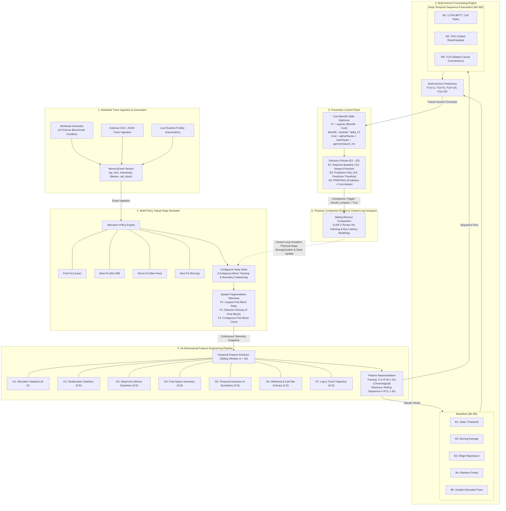

# PREFRAG: Predictive and Cost-Aware Memory Fragmentation Management Using Machine Learning

PREFRAG is a research framework for **multi-horizon memory fragmentation forecasting** and **cost-aware preventive memory reorganization**. It predicts future heap fragmentation using deep temporal sequence models and proactively triggers memory compaction only when the expected benefit outweighs the physical cost.

---

### 📐 Architecture



---

## 🚀 Quickstart & Setup

### Prerequisites
- **Python**: 3.10+ (tested on 3.14)
- **OS**: Windows / Linux / macOS

### 1. Create and Activate Virtual Environment
```bash
python -m venv .venv

# On Windows (PowerShell):
.venv\Scripts\Activate.ps1

# On Linux / macOS:
source .venv/bin/activate
```

### 2. Install Dependencies
```bash
pip install -r requirements.txt
```

### 3. Run Test Suite
```bash
python -m pytest tests/test_all.py -v
```

### 4. Run End-to-End Benchmark Experiments
```bash
python scripts/run_all_experiments.py
```

### 5. Record Live Memory Traces (Optional)
```bash
python scripts/record_live_trace.py
```

---

## 📁 Repository Structure

```
MemoryFragmentation/
├── src/
│   ├── traces/          # Trace schema, workload generators, CSV/JSON parsers
│   │   ├── trace_schema.py       # MemoryEvent, AllocationOp, TraceStream
│   │   ├── workload_generator.py # 10 workload families (Web, DB, Scientific, Microservice, Adversarial, etc.)
│   │   └── trace_parser.py       # External trace file ingestion
│   ├── simulator/       # Virtual heap allocator and fragmentation detection
│   │   ├── heap_allocator.py     # Multi-policy allocator (First/Best/Worst/Next-Fit) with coalescing & alloc_id tracking
│   │   ├── memory_block.py       # MemoryBlock data class with split logic
│   │   ├── fragmentation_metrics.py  # F1 (Largest Free Block Ratio), F2 (Shannon Entropy), F3
│   │   └── compaction_engine.py  # Sliding compaction with physical cost model
│   ├── features/        # 34-dimensional temporal feature extraction pipeline
│   │   └── feature_extractor.py  # 7 feature groups, multi-horizon target generation, online extraction
│   ├── models/          # Prediction models
│   │   ├── baselines.py          # B1-B5: Threshold, MovingAvg, Ridge, RandomForest, GBT
│   │   └── temporal_nn.py        # M1: LSTM, M2: GRU, M3: TCN (real implementations, pure NumPy)
│   ├── controller/      # Proactive reorganization decision engine
│   │   ├── cost_model.py         # Cost-Benefit Optimizer with realistic post-compaction estimates
│   │   └── policies.py           # E1-E5 decision policies
│   └── experiments/     # Evaluation harness
│       ├── runner.py             # E1-E5 simulation with consistent feature extraction
│       └── generalization.py     # Cross-workload generalization & feature ablation
├── scripts/
│   ├── run_all_experiments.py    # End-to-end benchmark orchestrator
│   └── record_live_trace.py      # Live memory profiler (SQLite, JSON, NumPy workloads)
├── tests/
│   └── test_all.py               # 8 unit & property tests
├── results/
│   ├── saved_traces/             # Generated workload traces (CSV)
│   ├── benchmark_report.md       # Full benchmark results
│   └── experiment_summary.json   # Machine-readable results
├── requirements.txt
└── README.md
```

---

## 🔬 Core Novelty & Methodology

### Problem
Memory fragmentation occurs when free memory is scattered across non-contiguous regions, preventing efficient allocation despite sufficient total free space. Existing approaches rely on reactive compaction (too late) or fixed-interval proactive compaction (wasteful).

### Our Approach
PREFRAG introduces a closed-loop system that:

1. **Predicts** future fragmentation at multiple horizons (t+1, t+5, t+10, t+30) using temporal deep learning models (LSTM, GRU, TCN) trained on 34-dimensional feature vectors extracted from allocation dynamics across 7 semantic groups.

2. **Proactively reorganizes** memory by triggering compaction only when the cost-benefit analysis yields positive net utility:

$$A^* = \arg\max_{A \in \mathcal{A}} \left[\text{ExpectedBenefit}(A) - \text{Cost}(A)\right]$$

### Models & Algorithms

| Model | Algorithm | Implementation |
|---|---|---|
| **B1** | Static Threshold (current F1 extrapolation) | Rule-based |
| **B2** | Exponential Moving Average | Smoothing |
| **B3** | Ridge Regression | scikit-learn |
| **B4** | Multi-Output Random Forest | scikit-learn |
| **B5** | Gradient Boosted Trees | scikit-learn |
| **M1** | LSTM (forget/input/output gates + cell state) | Pure NumPy + Adam |
| **M2** | GRU (reset/update gates) | Pure NumPy + Adam |
| **M3** | TCN (dilated causal 1D convolutions + residual connections) | Pure NumPy + Adam |

### Fragmentation Metrics

| Metric | Formula | Measures |
|---|---|---|
| **F1** | `1 - (largest_free_block / total_free_memory)` | Whether free memory can satisfy large allocations |
| **F2** | `-Σ pᵢ log₂(pᵢ)` (Shannon entropy of free blocks) | Dispersion/irregularity of free holes |
| **F3** | Count of disjoint free blocks | Raw fragmentation count |

### Experimental Conditions

| Condition | Strategy | Purpose |
|---|---|---|
| **E1** | Reactive Baseline | Compact only after severe fragmentation |
| **E2** | Always-Proactive | Compact at fixed intervals (high overhead) |
| **E3** | Prediction Only | Forecast without acting (ablation) |
| **E4** | ML + Threshold | Compact when predicted F1 exceeds threshold |
| **E5** | ML + Cost-Aware (PREFRAG) | Compact only when benefit > cost |

---

## 📊 Dataset

PREFRAG uses **reproducible synthetic allocation traces** and **live-captured memory profiles**:

### Synthetic Workload Traces (in `results/saved_traces/`)
| Trace | Description | Events |
|---|---|---|
| `web_server_trace.csv` | HTTP request bursts & session cache churn | 2,500 |
| `database_trace.csv` | B-Tree page buffer pool & transaction churn | 2,500 |
| `scientific_trace.csv` | Matrix/tensor phased cyclical allocations | 2,500 |
| `microservice_trace.csv` | Variable JSON/RPC objects, out-of-order frees | 2,500 |
| `adversarial_churn_trace.csv` | Pinned + transient checkerboarding | 2,500 |

### Live-Captured Traces
| Trace | Source | Capture Method |
|---|---|---|
| `live_sqlite_trace.csv` | Real SQLite DB transactions | `tracemalloc` |
| `live_microservice_trace.csv` | Real JSON serialization/parsing | `tracemalloc` |
| `live_scientific_trace.csv` | Real NumPy matrix allocations | `tracemalloc` |

To generate new traces:
```bash
python scripts/record_live_trace.py
```

---

## 📚 Literature Survey

The project includes a **24-paper verified literature survey** (2021–2025) covering:
- Memory fragmentation characterization & metrics
- Traditional allocation & compaction techniques
- ML/RL-based memory management
- GPU & LLM memory optimization
- CXL tiered memory & page migration

All papers are from verified top-tier venues: ASPLOS, OSDI, SOSP, USENIX ATC, NeurIPS, ICML, ISMM, SC, IEEE MCSoC, and peer-reviewed journals.

---

## License

MIT License

---

## Author

Sameer Kumar — VIT Vellore  
sameer.kumar2024@vitstudent.ac.in
