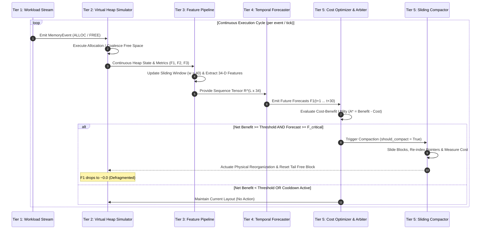

# PREFRAG: System Architecture & Compacted Blueprint

## 1. Executive Overview

**PREFRAG** is a predictive, cost-aware closed-loop memory reorganization framework. It addresses memory fragmentation by combining:
1. **Multi-Horizon Forecasting**: Predicting future heap fragmentation trajectories ($t+1, t+5, t+10, t+30$) via temporal sequence models trained on 34-dimensional allocation dynamics.
2. **Cost-Aware Preventive Control**: Determining whether memory compaction is cost-justified by balancing projected fragmentation reduction against hardware compaction overhead (memory bus latency, cache disruption, and stop-the-world pause times).


---

## 2. Compaction & Simplification Rationale

The original architecture diagram in `README.md` represented individual sub-components as 28 separate, fine-grained leaf nodes across 6 subgraphs. While exhaustive, this introduced visual complexity:
- **Redundant Ingestion Leaves**: Benchmark generators, CSV/JSON parsers, and live profilers occupied separate boxes despite converging to the same event abstraction.
- **Disconnected Allocator Policies**: Allocation policies (`First-Fit`, `Best-Fit`, `Worst-Fit`, `Next-Fit`) were plotted as separate floating boxes rather than configurable strategies inside a single allocator engine.
- **Excessive Feature Sprawl**: Seven individual boxes for feature groups G1–G7 created a wide horizontal fan-out.
- **Forecasting Engine Mesh**: 8 separate model boxes (B1–B5 and M1–M3) created cross-cutting connection arrows to the prediction target.
- **Decoupled Actuation**: The physical compaction engine was isolated in a separate subgraph rather than integrated into the closed-loop decision plane.

### Consolidation Mapping

| Original Subgraph / Nodes | Compacted Architecture Component | Consolidation & Simplification Rationale |
|---|---|---|
| **S1: Ingestion** (`WG`, `CP`, `LP`, `ES`) | **Tier 1: Workload Ingestion & Event Stream** | Merges synthetic generators, external parsers, and live profilers into a unified ingestion tier feeding a canonical `MemoryEvent` stream. |
| **S2: Allocator & Heap** (`AS`, `FF`, `BF`, `WF`, `NF`, `HS`, `FM`) | **Tier 2: Virtual Heap & Fragmentation Telemetry** | Unifies the 4 allocation algorithms into a single multi-policy engine coupled directly to contiguous heap state and spatial telemetry ($F_1, F_2, F_3$). |
| **S3: Feature Pipeline** (`FE`, `G1`–`G7`, `FV`) | **Tier 3: Temporal Feature Pipeline** | Consolidates all 7 feature groups (34 dimensions) into a single feature extractor with standardized dual outputs (sequence tensors and tabular vectors). |
| **S4: Forecasters** (`BL`, `B1`–`B5`, `DL`, `M1`–`M3`, `FO`) | **Tier 4: Multi-Horizon Forecasting Engine** | Streamlines baselines (B1–B5) and deep temporal models (M1–M3) into a dual-paradigm engine outputting multi-step predictions ($t+1, t+5, t+10, t+30$). |
| **S5 & S6: Control & Compaction** (`CBO`, `DP`, `CE`) | **Tier 5: Cost-Aware Control & Closed-Loop Actuation** | Integrates utility optimization, policy arbitration (E1–E5), and physical sliding compaction into a single closed-loop control system that updates the heap. |

---

## 3. Compacted Architecture Diagram

```mermaid
flowchart TD
    %% Tier 1: Ingestion
    subgraph S1["1. Workload Ingestion Tier"]
        direction TB
        IN["Multi-Source Workload Ingestion<br/>• 10 Benchmark Families (Web, DB, HPC, Microservices, etc.)<br/>• External Traces (CSV / JSON)<br/>• Live Runtime Profiler (tracemalloc)"]
        ES["Canonical MemoryEvent Stream<br/>(timestamp, op, address, size, lifetime, call_stack)"]
        IN -->|"Parse & Normalize"| ES
    end

    %% Tier 2: Heap Simulation & Telemetry
    subgraph S2["2. Virtual Heap & Fragmentation Telemetry"]
        direction TB
        ALLOC["Multi-Policy Allocator Engine<br/>• Policies: First-Fit | Best-Fit | Worst-Fit | Next-Fit<br/>• Contiguous Block Tracking & Boundary Tag Coalescing"]
        FM["Spatial Fragmentation Telemetry<br/>• F1: Largest Free Block Ratio<br/>• F2: Shannon Hole Entropy<br/>• F3: Disjoint Free Block Count"]
        ALLOC -->|"Continuous Heap Evaluation"| FM
    end

    %% Tier 3: Feature Pipeline
    subgraph S3["3. Temporal Feature Pipeline"]
        direction TB
        FE["34-D Feature Extractor (Sliding Window w = 40)<br/>• G1-G2: Allocation & Deallocation Dynamics (11-D)<br/>• G3-G4: Lifetime & Heap Geometry (9-D)<br/>• G5-G7: Dynamics, Context Entropy & Trend Lags (14-D)"]
        FT["Standardized Feature Representations<br/>• Sequence Tensor: R^(L x 34) for Deep Models<br/>• Tabular Snapshot: R^34 for Baselines"]
        FE -->|"Rolling Aggregation"| FT
    end

    %% Tier 4: Forecasting Engine
    subgraph S4["4. Multi-Horizon Forecasting Engine"]
        direction TB
        MODELS["Dual Model Architecture<br/>• Baselines (B1-B5): Threshold, EMA, Ridge, RF, GBT<br/>• Deep Temporal (M1-M3): LSTM, GRU, Dilated Causal TCN"]
        PRED["Multi-Horizon Predictions<br/>F1(t+1), F1(t+5), F1(t+10), F1(t+30)"]
        MODELS -->|"Inference Forward Pass"| PRED
    end

    %% Tier 5: Control Plane & Actuation
    subgraph S5["5. Cost-Aware Control & Closed-Loop Actuation"]
        direction TB
        CTRL["Preventive Decision Plane<br/>• Cost-Benefit Optimizer: A* = argmax (Benefit - Cost)<br/>• Policy Arbiter: E1-E4 Baselines vs. E5 PREFRAG"]
        COMPACT["Sliding Memory Compaction (LISP-2)<br/>• Pointer Re-indexing & Block Relocation<br/>• Latency & Memory Bus Bandwidth Emulation"]
        CTRL -->|"Trigger: should_compact = True"| COMPACT
    end

    %% Pipeline Interconnections
    ES -->|"Event Ingestion"| ALLOC
    FM -->|"Live State Snapshots"| FE
    FT -->|"Features Flow"| MODELS
    PRED -->|"Forecast Trajectory"| CTRL
    COMPACT -.->|"Closed-Loop Actuation: Heap Reorganization & State Reset"| ALLOC

    classDef primary fill:#e3f2fd,stroke:#1565c0,stroke-width:2px;
    classDef success fill:#e8f5e9,stroke:#2e7d32,stroke-width:2px;
    classDef warning fill:#fff3e0,stroke:#e65100,stroke-width:2px;
    class IN,ALLOC,FE,MODELS,CTRL primary;
    class ES,FM,FT,PRED,COMPACT success;
```



---

## 4. Architectural Tier Specifications

### Tier 1: Workload Ingestion & Event Stream
The workload tier unifies three complementary trace acquisition mechanisms into an event stream:
- **Synthetic Workload Generator**: Generates 10 reproducible benchmark patterns capturing production behaviors:
  1. *Web Server*: Bursty HTTP request payloads, transient session churn.
  2. *Database Buffer Pool*: B-Tree page splits, persistent caches, LRU eviction churn.
  3. *Scientific Computing*: Phased matrix allocations, large contiguous buffers.
  4. *Microservice / REST*: Small JSON objects, high allocation rates, out-of-order frees.
  5. *Adversarial Checkerboard*: Pinned long-lived objects interspersed with short-lived objects.
  6. *Streaming Pipeline*, *Compilation Workload*, *Graphics/Frame-based*, *Batch Processing*, and *Cyclical Batches*.
- **External Trace Parser**: Ingests external real-world traces formatted in CSV or JSON.
- **Live Runtime Profiler**: Uses Python's `tracemalloc` to capture actual execution allocations from real libraries (SQLite, NumPy, JSON serializers).
- **Canonical Schema**:
  ```python
  MemoryEvent(
      timestamp: float,
      op: AllocationOp,       # ALLOC, FREE, REALLOC
      address: int,           # Virtual heap block address
      size: int,              # Size in bytes
      lifetime: float,        # Object lifespan (when known/profiled)
      call_stack_hash: int,   # Allocation site identifier
      thread_id: int,         # Originating thread ID
      tag: str                # Workload semantic metadata
  )
  ```

---

### Tier 2: Virtual Heap Simulator & Telemetry Engine
Simulates a contiguous byte-addressable virtual heap with realistic boundary constraints:
- **Allocation Policies**:
  - `First-Fit`: Allocates the first free block satisfying size criteria (low search overhead).
  - `Best-Fit`: Allocates the free block closest in size, minimizing residual split size.
  - `Worst-Fit`: Allocates the largest free block, leaving larger remaining fragments.
  - `Next-Fit`: Roving pointer allocation from the last search position.
- **Block Coalescing**: On deallocation, adjacent free blocks are immediately merged via boundary tag coalescing to eliminate false external fragmentation.
- **Spatial Fragmentation Metrics**:
  - **F1 (Largest Free Block Ratio)**:
    $$F_1 = 1 - \frac{\text{largest free block size}}{\text{total free memory}}$$
    *Semantics*: Measures whether remaining free memory can satisfy large contiguous allocations. $F_1 \approx 0$ represents completely unfragmented free space; $F_1 \approx 1$ indicates severe fragmentation.
  - **F2 (Shannon Hole Entropy)**:
    $$F_2 = -\sum_{i=1}^{K} p_i \log_2(p_i) \quad \text{where } p_i = \frac{\text{size}(H_i)}{\text{total free bytes}}$$
    *Semantics*: Quantifies the dispersion and irregularity of free holes across the heap.
  - **F3 (Disjoint Free Block Count)**:
    $$F_3 = K = |\{H_1, H_2, \dots, H_K\}|$$
    *Semantics*: The raw count of disjoint unallocated regions.

---

### Tier 3: 34-Dimensional Feature Pipeline
Extracts 34 normalized features across a sliding window of historical events ($w = 40$), organized into 7 semantic groups:

```
┌────────────────────────────────────────────────────────────────────────┐
│               34-Dimensional Feature Representation                     │
├────────────────────────────────┬───────────────────────────────────────┤
│ Group                          │ Features (Count)                      │
├────────────────────────────────┼───────────────────────────────────────┤
│ G1: Allocation Statistics      │ count, total_bytes, mean, std,        │
│                                │ max_size, alloc_rate (6-D)            │
│ G2: Deallocation Statistics    │ count, total_bytes, mean, std,        │
│                                │ free_rate (5-D)                       │
│ G3: Lifetime Dynamics          │ mean_lifetime, std_lifetime,          │
│                                │ short_lived_ratio (3-D)               │
│ G4: Free-Space / Heap Geometry │ current_F1, current_F2, current_F3,   │
│                                │ total_free, largest_free, util (6-D)  │
│ G5: Temporal Dynamics          │ delta_F1, delta_F2, delta_alloc_bytes,│
│                                │ alloc_burstiness, alloc/free (5-D)    │
│ G6: Workload Context & Entropy │ active_count, active_payload_bytes,   │
│                                │ call_stack_entropy (3-D)              │
│ G7: Lag & Trend Trajectory     │ F1_lag1, F1_lag5, F1_lag10,           │
│                                │ F1_trend5, F1_volatility10,           │
│                                │ alloc_rate_trend (6-D)                │
└────────────────────────────────┴───────────────────────────────────────┘
```

- **Output Representations**:
  - `Sequence Tensor` $X_{\text{seq}} \in \mathbb{R}^{L \times 34}$: Historical sliding sequences fed into recurrent/convolutional deep networks.
  - `Tabular Vector` $x_{\text{tab}} \in \mathbb{R}^{34}$: Point-in-time snapshot for decision trees and linear baselines.

---

### Tier 4: Multi-Horizon Forecasting Engine
Predicts future fragmentation $F_1(t+k)$ for multiple horizons $k \in \{1, 5, 10, 30\}$ steps ahead:

```
                    ┌─────────────────────────┐
                    │ Standardized Features   │
                    └───────────┬─────────────┘
                                │
          ┌─────────────────────┴─────────────────────┐
          ▼                                           ▼
┌───────────────────────────┐               ┌───────────────────────────┐
│ Baselines (B1 - B5)       │               │ Deep Temporal (M1 - M3)   │
├───────────────────────────┤               ├───────────────────────────┤
│ B1: Static Threshold      │               │ M1: LSTM                  │
│ B2: Moving Average (EMA)  │               │     (Cell State + Gates)  │
│ B3: Ridge Regression      │               │ M2: GRU                   │
│ B4: Random Forest         │               │     (Reset/Update Gates)  │
│ B5: Gradient Boosted Trees│               │ M3: Dilated Causal TCN    │
└─────────────┬─────────────┘               └─────────────┬─────────────┘
              │                                           │
              └─────────────────────┬─────────────────────┘
                                    ▼
                    ┌─────────────────────────┐
                    │ Multi-Horizon Outputs   │
                    │ F1(t+1), F1(t+5),       │
                    │ F1(t+10), F1(t+30)      │
                    └─────────────────────────┘
```

- **Baselines (B1–B5)**:
  - `B1`: Current value extrapolation.
  - `B2`: Exponential Moving Average (EMA) of historical $F_1$.
  - `B3`: Ridge regularized linear regression.
  - `B4`: Multi-output Random Forest regressor.
  - `B5`: Gradient Boosted Decision Trees (LightGBM/XGBoost style).
- **Deep Sequence Models (M1–M3)** (implemented in pure NumPy + Adam optimizer):
  - `M1 (LSTM)`: Captures long-range temporal dependencies using forget, input, and output gates with linear cell state carryover.
  - `M2 (GRU)`: Lightweight gated recurrent architecture with reset and update gates.
  - `M3 (TCN)`: Temporal Convolutional Network using stacked 1D dilated causal convolutions and residual connections.

---

### Tier 5: Cost-Aware Control & Closed-Loop Actuation
Determines whether to intervene based on a cost-benefit optimization objective:

$$A^* = \arg\max_{A \in \{\text{NoAction}, \text{Compact}\}} \left[ \text{ExpectedBenefit}(A) - \text{Cost}(A) \right]$$

#### 1. Expected Benefit Formulation
$$\text{ExpectedBenefit} = \lambda \cdot \max\left(0, \hat{F}_{1,\text{future}} - F_{1,\text{post}}\right)$$
- $\lambda$: Economic value per unit of fragmentation prevented (default $\lambda = 100.0$).
- $\hat{F}_{1,\text{future}}$: Deep learning forecast of future fragmentation.
- $F_{1,\text{post}}$: Estimated post-compaction fragmentation accounting for alignment constraints.

#### 2. Physical Compaction Cost Formulation
$$\text{Cost} = \alpha \cdot N_{\text{blocks}} + \beta \cdot B_{\text{bytes}} + \gamma \cdot T_{\text{pause}}$$
- $\alpha$: CPU overhead for pointer updates and relocation table bookkeeping.
- $\beta$: Memory bus bandwidth consumption factor ($B_{\text{bytes}} / \text{Bandwidth}$).
- $\gamma$: Latency penalty incurred by Stop-The-World (STW) execution pause.

#### 3. Policy Arbiter (E1–E5)
- **E1 (Reactive Baseline)**: Compacts only after actual $F_1(t) \ge 0.65$.
- **E2 (Always-Proactive)**: Compacts unconditionally at fixed intervals (e.g., every 25 ticks).
- **E3 (Prediction Only)**: Forecasts without triggering compaction (observational baseline).
- **E4 (ML + Threshold)**: Compacts whenever predicted $\hat{F}_1(t+k) \ge 0.65$.
- **E5 (PREFRAG Core)**: Compacts if and only if:
  $$\text{NetBenefit} = \text{ExpectedBenefit} - \text{Cost} \ge \tau_{\min} \quad \text{AND} \quad \hat{F}_1(t+k) \ge F_{\text{critical}}$$
  with an adaptive hysteresis cooldown to prevent compaction thrashing.

#### 4. Sliding Compaction (LISP-2 Style)
When triggered, the compactor:
1. Calculates forwarding addresses for all active allocated blocks.
2. Updates references/pointers.
3. Slides active blocks toward the low-address end of the heap.
4. Coalesces all remaining free space into a single contiguous tail block at the high-address end.
5. Emits closed-loop telemetry updates directly back to the Virtual Heap Allocator.

---

## 5. End-to-End Operational Lifecycle

The closed-loop interaction between tiers proceeds through the following execution sequence:



---

## 6. Architecture Comparison Matrix

| Architectural Dimension | Original README Diagram | Compacted Architecture Diagram |
|---|---|---|
| **Total Diagram Nodes** | 28 individual nodes | 10 cohesive functional nodes |
| **Ingestion Representation** | 3 separate generator/parser/profiler leaf boxes | 1 unified ingestion tier feeding a standardized event stream |
| **Allocator Representation** | 4 dangling leaf policy nodes (`FF`, `BF`, `WF`, `NF`) | Consolidated multi-policy allocator with strategy encapsulation |
| **Feature Engineering** | 7 horizontal group boxes (`G1`–`G7`) with wide fan-out | Single structured feature block specifying dimensions and output types |
| **Model Architectures** | 8 individual model boxes with tangled cross-lines | Clear dual-paradigm grouping (Baselines vs. Deep Temporal Models) |
| **Compaction & Control** | Disconnected control plane (S5) and compactor (S6) | Integrated closed-loop decision and physical actuation tier |
| **Feedback Loop Visibility** | Weakly represented feedback path | Explicit closed-loop feedback arrow returning to contiguous heap state |
| **Cognitive Load & Readability** | High clutter, difficult to inspect at a glance | High clarity, modular abstraction with clear information hierarchy |

---

## 7. Implementation Cross-References

| Architectural Tier | Primary Source Modules | Core Symbols & Classes |
|---|---|---|
| **Tier 1: Workload Ingestion** | [trace_schema.py](file:///c:/Users/s/CODING%20JOURNEY/MemoryFragmentation/src/traces/trace_schema.py)<br/>[workload_generator.py](file:///c:/Users/s/CODING%20JOURNEY/MemoryFragmentation/src/traces/workload_generator.py)<br/>[trace_parser.py](file:///c:/Users/s/CODING%20JOURNEY/MemoryFragmentation/src/traces/trace_parser.py) | [`MemoryEvent`](file:///c:/Users/s/CODING%20JOURNEY/MemoryFragmentation/src/traces/trace_schema.py#L19), [`AllocationOp`](file:///c:/Users/s/CODING%20JOURNEY/MemoryFragmentation/src/traces/trace_schema.py#L12), [`WorkloadGenerator`](file:///c:/Users/s/CODING%20JOURNEY/MemoryFragmentation/src/traces/workload_generator.py#L15) |
| **Tier 2: Virtual Heap & Metrics** | [heap_allocator.py](file:///c:/Users/s/CODING%20JOURNEY/MemoryFragmentation/src/simulator/heap_allocator.py)<br/>[memory_block.py](file:///c:/Users/s/CODING%20JOURNEY/MemoryFragmentation/src/simulator/memory_block.py)<br/>[fragmentation_metrics.py](file:///c:/Users/s/CODING%20JOURNEY/MemoryFragmentation/src/simulator/fragmentation_metrics.py) | [`VirtualHeapAllocator`](file:///c:/Users/s/CODING%20JOURNEY/MemoryFragmentation/src/simulator/heap_allocator.py#L18), [`MemoryBlock`](file:///c:/Users/s/CODING%20JOURNEY/MemoryFragmentation/src/simulator/memory_block.py#L12), [`FragmentationCalculator`](file:///c:/Users/s/CODING%20JOURNEY/MemoryFragmentation/src/simulator/fragmentation_metrics.py#L22) |
| **Tier 3: Feature Pipeline** | [feature_extractor.py](file:///c:/Users/s/CODING%20JOURNEY/MemoryFragmentation/src/features/feature_extractor.py) | [`TemporalFeatureExtractor`](file:///c:/Users/s/CODING%20JOURNEY/MemoryFragmentation/src/features/feature_extractor.py#L86), [`TemporalFeatureVector`](file:///c:/Users/s/CODING%20JOURNEY/MemoryFragmentation/src/features/feature_extractor.py#L15) |
| **Tier 4: Forecasting Engine** | [baselines.py](file:///c:/Users/s/CODING%20JOURNEY/MemoryFragmentation/src/models/baselines.py)<br/>[temporal_nn.py](file:///c:/Users/s/CODING%20JOURNEY/MemoryFragmentation/src/models/temporal_nn.py) | [`BaselineSuite`](file:///c:/Users/s/CODING%20JOURNEY/MemoryFragmentation/src/models/baselines.py#L16), [`LSTMForecaster`](file:///c:/Users/s/CODING%20JOURNEY/MemoryFragmentation/src/models/temporal_nn.py#L18), [`GRUForecaster`](file:///c:/Users/s/CODING%20JOURNEY/MemoryFragmentation/src/models/temporal_nn.py#L160), [`TCNForecaster`](file:///c:/Users/s/CODING%20JOURNEY/MemoryFragmentation/src/models/temporal_nn.py#L290) |
| **Tier 5: Control & Actuation** | [cost_model.py](file:///c:/Users/s/CODING%20JOURNEY/MemoryFragmentation/src/controller/cost_model.py)<br/>[policies.py](file:///c:/Users/s/CODING%20JOURNEY/MemoryFragmentation/src/controller/policies.py)<br/>[compaction_engine.py](file:///c:/Users/s/CODING%20JOURNEY/MemoryFragmentation/src/simulator/compaction_engine.py) | [`CostBenefitOptimizer`](file:///c:/Users/s/CODING%20JOURNEY/MemoryFragmentation/src/controller/cost_model.py#L26), [`CostAwarePredictivePolicy`](file:///c:/Users/s/CODING%20JOURNEY/MemoryFragmentation/src/controller/policies.py#L82), [`CompactionEngine`](file:///c:/Users/s/CODING%20JOURNEY/MemoryFragmentation/src/simulator/compaction_engine.py#L25) |
| **Harness & Benchmark** | [runner.py](file:///c:/Users/s/CODING%20JOURNEY/MemoryFragmentation/src/experiments/runner.py)<br/>[generalization.py](file:///c:/Users/s/CODING%20JOURNEY/MemoryFragmentation/src/experiments/generalization.py) | [`ExperimentRunner`](file:///c:/Users/s/CODING%20JOURNEY/MemoryFragmentation/src/experiments/runner.py#L22) |

